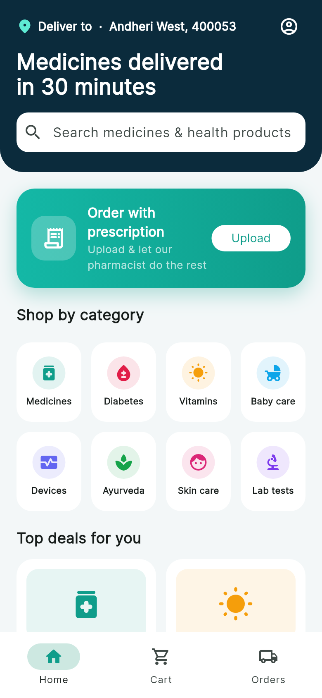
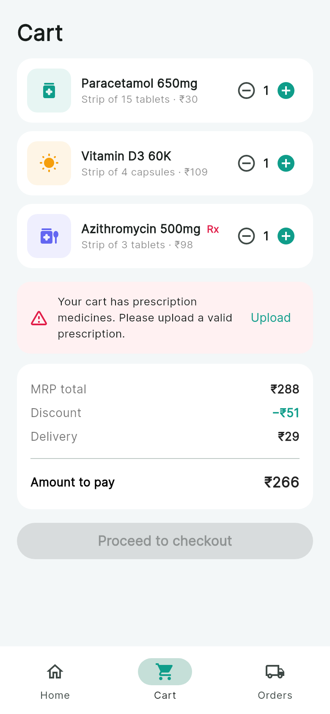
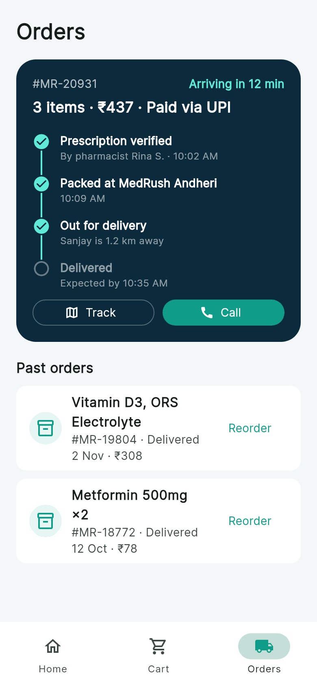

# Medicine Delivery App Development | Online Pharmacy App & Software

Build a modern online medicine ordering and delivery platform with **Naya Prayog Technologies**.

We provide custom **medicine delivery app development** services for pharmacies, e-pharmacy startups, medicine retailers, healthcare businesses, and entrepreneurs looking to bring their pharmacy operations online.

From customer-facing medicine ordering applications to pharmacy management dashboards and delivery management systems, we help businesses develop digital pharmacy solutions tailored to their operational requirements.

Whether you are planning an online pharmacy startup, expanding an existing pharmacy business, or building a multi-vendor medicine marketplace, we can help transform your idea into a scalable software solution.

**Looking for a Medicine Delivery App Development Company?**

Let's discuss your project.

- Website: https://nayaprayog.com/
- Email: support@nayaprayog.com
- Phone / WhatsApp: +91 7991327022
- Direct WhatsApp: https://wa.me/917991327022
- Portfolio: https://github.helloharendra.io

---

<!-- screenshots -->
## Screenshots

<table>
  <tr>
    <td align="center"><b>Home</b>  </td>
    <td align="center"><b>Cart & Checkout</b>  </td>
    <td align="center"><b>Orders</b>  </td>
  </tr>
</table>

---

## Medicine Delivery App Development Services

We develop custom pharmacy applications and medicine delivery software designed to connect customers, pharmacies, administrators, and delivery partners.

Depending on the project scope, a solution can include Android applications, iOS applications, web platforms, backend APIs, and centralized administration dashboards.

### 1. Customer Medicine Ordering App

A customer-facing mobile application that allows users to discover medicines and place orders online.

Potential features:

- Customer registration and login
- User profile management
- Medicine search and discovery
- Medicine categories and product listings
- Medicine details and pricing
- Prescription upload
- Shopping cart and checkout
- Online payment integration
- Order confirmation
- Order history
- Delivery status tracking
- Push notifications
- Customer support

### 2. Pharmacy Management Application

A dedicated application or dashboard for pharmacies to manage medicine catalogs and incoming orders.

Potential features:

- Pharmacy registration and profile management
- Medicine catalog management
- Product pricing and availability
- Stock and inventory management
- Order acceptance and processing
- Prescription review workflows
- Order preparation status
- Sales records
- Pharmacy performance reports
- Customer order management

### 3. Delivery Partner App

A dedicated delivery application to manage medicine deliveries and order assignments.

Potential features:

- Delivery partner registration
- Secure login
- Order assignment
- Pickup and delivery information
- Order status updates
- Delivery history
- Location and navigation integration
- Delivery notifications
- Delivery performance reports

### 4. Admin Dashboard

A centralized web-based administration platform to manage the overall pharmacy delivery ecosystem.

Potential features:

- Customer management
- Pharmacy management
- Delivery partner management
- Medicine category management
- Product and inventory monitoring
- Order management
- Payment and transaction records
- Commission configuration
- Promotional offers and coupons
- Reports and analytics
- Platform configuration
- Role and permission management

### 5. Multi-Vendor Pharmacy Marketplace

Build a multi-pharmacy medicine delivery marketplace that allows multiple pharmacies to participate in one digital platform.

Potential capabilities:

- Multiple pharmacy onboarding
- Pharmacy-specific medicine catalogs
- Location-based pharmacy discovery
- Pharmacy availability management
- Order routing and assignment
- Pharmacy-wise order management
- Commission and settlement workflows
- Centralized marketplace administration

### 6. Online Payment and Order Management

Integrate payment and order workflows to make the ordering experience convenient and manageable.

Potential capabilities:

- Payment gateway integration
- Cash-on-delivery configuration where permitted
- Online payment status
- Order confirmation
- Refund workflows
- Order cancellation
- Invoice and receipt generation
- Transaction history

---

## How a Medicine Delivery Platform Works

A typical medicine delivery platform can involve four main user roles.

| User Role | Main Responsibilities |
|---|---|
| Customer | Search medicines, upload prescriptions, place orders, and track deliveries |
| Pharmacy | Manage medicine listings, verify orders, and prepare medicines |
| Delivery Partner | Accept assigned deliveries and update delivery status |
| Admin | Manage users, pharmacies, products, orders, payments, and platform operations |

The exact workflow can be customized for a single-pharmacy business or a multi-vendor marketplace.

---

## Types of Medicine Delivery Applications We Can Build

| Solution | Ideal For |
|---|---|
| Online Pharmacy App | Traditional pharmacies moving online |
| Medicine Delivery App | Local medicine delivery businesses |
| E-Pharmacy Platform | Online pharmacy startups |
| Multi-Vendor Pharmacy App | Pharmacy marketplace businesses |
| Pharmacy Management Software | Independent pharmacy stores |
| Prescription Ordering App | Prescription-based medicine ordering workflows |
| Healthcare Marketplace | Businesses offering multiple healthcare services |
| Medicine Inventory System | Pharmacy stock and catalog management |

---

## Business Benefits

A well-designed medicine delivery platform can help businesses:

- Expand their pharmacy business through digital channels
- Make medicine discovery and ordering more convenient
- Organize pharmacy orders and inventory
- Coordinate delivery operations
- Improve visibility into business performance
- Manage multiple pharmacies from one platform
- Build stronger customer engagement
- Support future business expansion

---

## Why Choose Naya Prayog Technologies?

**Custom Development**  
We develop software around your business model, operational workflows, and customer requirements.

**Multi-Platform Applications**  
Depending on the scope, solutions can include Android, iOS, and web applications.

**Scalable Architecture**  
We plan the application architecture around expected users, pharmacies, products, transactions, and future expansion.

**Business Automation**  
Automate suitable workflows involving orders, inventory, pharmacy operations, delivery management, and reporting.

**Third-Party Integrations**  
Integrate supported payment gateways, notification services, maps, and other required APIs.

**End-to-End Development**  
We can work across UI/UX design, application development, backend APIs, administration dashboards, deployment, and ongoing maintenance.

---

## Technology Stack

The technology stack is selected according to the project's scope and technical requirements.

Potential technologies include:

- **Mobile Applications:** Flutter, Android, iOS
- **Frontend:** React, Next.js
- **Backend:** Node.js, REST APIs
- **Database:** Firebase, MySQL, PostgreSQL, MongoDB
- **Cloud and Deployment:** VPS and cloud infrastructure
- **Integrations:** Payment gateways, maps, notifications, and third-party APIs

---

## Security, Prescription Handling and Regulatory Considerations

Medicine delivery platforms may process sensitive personal information, prescriptions, and healthcare-related data. Their development requires careful consideration of security and applicable regulations.

Depending on the target market and business model, important considerations include:

- Secure customer authentication
- Role-based access control
- Secure handling of uploaded prescriptions
- Appropriate protection of personal and medical information
- Encrypted communication
- Order and payment record security
- Prescription verification workflows
- Audit trails and administrative access controls
- Applicable pharmacy, medicine-sale, and data protection regulations

Prescription validation, medicine availability, pharmacist review, and order fulfilment workflows must be designed around applicable legal requirements. The platform itself does not automatically authorize the sale or delivery of regulated medicines.

Regulatory and licensing requirements should be reviewed with qualified professionals before launching the service.

---

## Medicine Delivery App Development Process

1. **Business Requirement Analysis** – Understand your pharmacy business model, target customers, and delivery operations.
2. **Feature Planning** – Define customer, pharmacy, delivery partner, and admin modules.
3. **UI/UX Design** – Design user-friendly mobile and web experiences.
4. **Application Development** – Build the applications, backend APIs, database, and administration dashboard.
5. **Integration** – Connect required payment, maps, notifications, and third-party services.
6. **Testing and Quality Assurance** – Validate application workflows, usability, and security controls.
7. **Deployment** – Prepare and deploy the agreed application components.
8. **Maintenance and Enhancement** – Support future updates and business expansion as agreed.

---

## Frequently Asked Questions

### What is medicine delivery app development?

Medicine delivery app development involves creating digital platforms that allow customers to search for medicines, submit prescriptions where required, place orders, make payments, and receive deliveries through participating pharmacies.

### Can you develop an online pharmacy app for my business?

Yes. We can develop a custom online pharmacy application based on your business model, whether you operate one pharmacy or plan to build a multi-vendor platform.

### Can you build separate customer, pharmacy, delivery, and admin applications?

Yes. Depending on project requirements, the platform can include separate mobile applications or interfaces for customers, pharmacies, delivery partners, and administrators.

### Can you develop a multi-vendor medicine delivery platform?

Yes. We can develop a marketplace model with multiple pharmacies, pharmacy-specific catalogs, order management, commission workflows, and centralized administration.

### Can customers upload prescriptions?

Prescription upload and review workflows can be included where required. The verification and fulfilment process must follow applicable regulations and pharmacy requirements.

### Can you integrate online payments and live delivery tracking?

Supported payment gateways and location or mapping services can be integrated according to the project requirements and third-party provider capabilities.

### How much does medicine delivery app development cost?

The cost depends on the number of applications, modules, integrations, user roles, design complexity, and backend infrastructure. Contact us to discuss your requirements and receive a project estimate.

---

## Start Your Medicine Delivery App Project

Planning to launch an online pharmacy, medicine delivery startup, or multi-vendor pharmacy marketplace?

**Naya Prayog Technologies** can help you plan and develop a custom digital pharmacy solution.

**Discuss Your Project With Our Team**

- Website: https://nayaprayog.com/
- Email: support@nayaprayog.com
- Phone / WhatsApp: +91 7991327022
- Direct WhatsApp: https://wa.me/917991327022
- Portfolio: https://github.helloharendra.io

**Naya Prayog Technologies**  
Custom Software Development | Mobile App Development | Healthcare Technology | Business Automation

---

## Repository Information

This repository is a service and portfolio showcase for medicine delivery app development by Naya Prayog Technologies.

The features described above represent potential development capabilities and solution modules. They should not be interpreted as confirmation that every feature is implemented in a ready-to-use application.

**Proprietary Notice:** This repository is a project showcase. No permission to redistribute, reuse, or commercially exploit proprietary source code, branding, or materials is granted unless separately authorized in writing.
